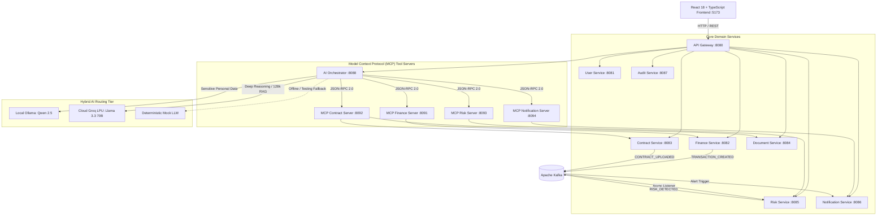

# FinOrchestrator — Personal Financial AI Agent

[](https://openjdk.org/projects/jdk/21/)
[](https://spring.io/projects/spring-boot)
[](https://react.dev/)
[](https://modelcontextprotocol.io/)
[-blueviolet.svg)](https://groq.com/)
[-teal.svg)](https://ollama.ai/)
[](LICENSE)

**FinOrchestrator** is an enterprise-grade personal financial AI orchestration platform.

The goal is **NOT** a simple chatbot. It is a production-oriented platform where an AI orchestrator understands user requests, determines required domain capabilities, calls specialized backend services via standardized **Model Context Protocol (MCP)** tools, retrieves verified financial data, performs **deterministic financial calculations**, and generates explainable responses with full execution auditability.

---

## 🏛️ System Architecture



---

## 🔑 Core Engineering Principles

1. **Deterministic Financial Math**:
   - The LLM is **never** permitted to calculate account balances, runway months, debt ratios, or interest rates.
   - All arithmetic uses `java.math.BigDecimal` in backend microservices with explicit scale and `RoundingMode.HALF_UP`.
   - **Pure deterministic queries** (e.g. *"What is my balance?"* or *"What did I spend this month?"*) bypass the LLM completely.
2. **Model Context Protocol (MCP) Integration**:
   - 24 standardized tools across 4 standalone servers communicating over JSON-RPC 2.0 (`tools/list` and `tools/call`).
3. **Hybrid AI Engine**:
   - **Local Tier (Ollama / Qwen 2.5)**: Zero-data-leakage processing for sensitive balances.
   - **Cloud Tier (Groq LPU / Llama-3.3-70B-Versatile)**: Blazing-fast inference (< 400ms) with 128k token context for multi-page contract RAG.
   - **Deterministic Fallback Tier (`MockLLMProvider`)**: Instant offline fallback with zero external dependencies.
4. **Transparent Explainability ("How this answer was generated")**:
   - Every AI answer features an inspectable execution trace detailing intent classification, step-by-step plan, MCP tool inputs/outputs, latency, and citations.
5. **Event-Driven Resilience**:
   - Apache Kafka domain events, Resilience4j circuit breakers, Redis rate limiting, and MySQL optimistic locking (`@Version`).

---

## 🔌 Microservice & Port Directory

| Service | Port | Function |
|---|---|---|
| **`api-gateway`** | `8080` | Reverse proxy, JWT validation, Redis token bucket rate limiter, CORS |
| **`user-service`** | `8081` | Authentication, user registration, budget preferences, BCrypt security |
| **`finance-service`** | `8082` | Double-entry accounts, transaction ledger, cash flow, category aggregations |
| **`contract-service`** | `8083` | Contract terms, obligations, renewal dates, penalty clauses |
| **`document-service`** | `8084` | PDF extraction (PDFBox), clause chunking, 384d dense embeddings, Qdrant vector store |
| **`risk-service`** | `8085` | Cash runway buffer simulation, spending anomaly detection, debt ratios |
| **`notification-service`** | `8086` | Reminders, calendar alerts, contract expiration warnings |
| **`audit-service`** | `8087` | Immutable decision logs, execution traces, compliance inspector |
| **`ai-orchestrator`** | `8088` | Intent classifier, agent planner, MCP client, hybrid LLM router, synthesizer |
| **`mcp-finance-server`** | `8091` | JSON-RPC 2.0 tool layer (8 tools) |
| **`mcp-contract-server`**| `8092` | JSON-RPC 2.0 tool layer (8 tools) |
| **`mcp-risk-server`** | `8093` | JSON-RPC 2.0 tool layer (5 tools) |
| **`mcp-notification-server`**| `8094` | JSON-RPC 2.0 tool layer (3 tools) |
| **`frontend`** | `5173` | React 18, TypeScript, Tailwind CSS, Recharts, Execution Trace Drawer |

---

## 💻 Frontend Pages (10 Dedicated Views)

1. **Dashboard** (`/dashboard`): Real-time liquidity KPI cards, monthly cash flow area charts, spending-by-category breakdown, and quick AI prompts.
2. **AI Assistant** (`/ai-assistant`): Interactive conversational copilot with markdown formatting, query citations, and the **"How this answer was generated"** drawer.
3. **Transactions** (`/transactions`): Filterable transaction ledger with modal for recording new income/expense debits.
4. **Accounts** (`/accounts`): Multi-institution overview (HDFC Salary Checking, ICICI Savings, HDFC Regalia Credit Card).
5. **Financial Analytics** (`/analytics`): Average daily burn rate, projected month-end balance, and cash flow trends.
6. **Contracts & Terms** (`/contracts`): Structured contract terms, renewal dates, late payment penalties, and prepayment fees.
7. **Document Upload** (`/upload`): PDF drag-and-drop ingestion with multi-stage progress tracker and semantic vector search testbed.
8. **Risk Alerts** (`/risk-alerts`): Cash runway buffer status, emergency margin surplus, spending anomaly warnings, and fixed obligations.
9. **Notifications** (`/notifications`): Reminder scheduling dialog, due date alerts, and priority filters.
10. **Audit Traces** (`/audit`): Distributed tracing inspector, correlation ID tracker, MCP tool call timeline, and latency analysis.

---

## 🚀 Quickstart Guide

### Prerequisites
* **Java 21+** (JDK 21 or 25)
* **Maven 3.9+** (or use bundled `./mvnw`)
* **Docker & Docker Compose**
* **Node.js 18+ & npm**

### 1. Start Infrastructure Dependencies
Launch MySQL 8.0, Redis 7.0, Zookeeper, Apache Kafka, Qdrant, Prometheus, and Grafana:

```bash
cd infrastructure
docker-compose up -d
```
* MySQL initializes automatically with complete seed schemas from `infrastructure/mysql/init.sql`.

### 2. Configure Environment Variables (Optional)
To enable Cloud Groq LPU inference, export your free API key:
```bash
export GROQ_API_KEY="your-free-groq-api-key"
```
*(If no API key is provided, the platform automatically activates the deterministic `MockLLMProvider` for offline execution.)*

### 3. Build All Java Microservices
Run the root Maven build:
```bash
./mvnw clean install -DskipTests
```

### 4. Run the Backend Microservices
You can launch any service individually using Spring Boot:
```bash
# Core Services
./mvnw spring-boot:run -pl api-gateway
./mvnw spring-boot:run -pl user-service
./mvnw spring-boot:run -pl finance-service
./mvnw spring-boot:run -pl risk-service
./mvnw spring-boot:run -pl contract-service
./mvnw spring-boot:run -pl document-service
./mvnw spring-boot:run -pl notification-service
./mvnw spring-boot:run -pl audit-service

# MCP Servers
./mvnw spring-boot:run -pl mcp-servers/mcp-finance-server
./mvnw spring-boot:run -pl mcp-servers/mcp-contract-server
./mvnw spring-boot:run -pl mcp-servers/mcp-risk-server
./mvnw spring-boot:run -pl mcp-servers/mcp-notification-server

# AI Orchestrator
./mvnw spring-boot:run -pl ai-orchestrator
```

### 5. Launch the React Frontend
```bash
cd frontend
npm install
npm run dev
```
Open [http://localhost:5173](http://localhost:5173) in your browser.

---

## 🧪 Automated Testing

Execute deterministic math and orchestrator planning unit tests:
```bash
# Test deterministic finance math (BigDecimal net worth, savings rates, zero-division safety)
./mvnw test -pl finance-service

# Test cash runway buffer and transaction risk evaluation
./mvnw test -pl risk-service

# Test intent classification, deterministic bypass, and multi-step agent planning
./mvnw test -pl ai-orchestrator
```

---

## 📚 Technical Documentation

* [System Architecture & Sequence Flows](docs/architecture.md)
* [Model Context Protocol (MCP) 24 Tools Catalog](docs/mcp-tools.md)
* [REST API Contracts & Gateway Routes](docs/api-contracts.md)
* [Kafka Event Contracts & Topic Schemas](docs/event-contracts.md)
* [Database Normalization & Indexing Design](docs/database-design.md)
* [Failure Scenarios & Resilience Guide](docs/failure-scenarios.md)
