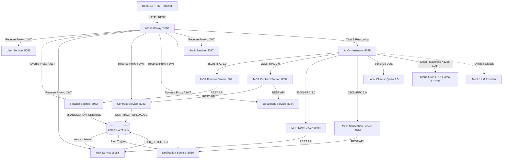
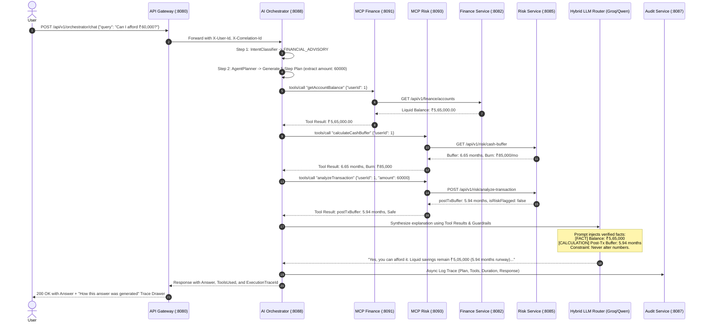
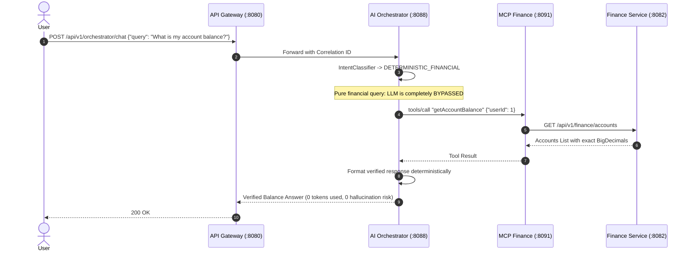

# FinOrchestrator — Architecture & System Design

## 1. System Overview

**FinOrchestrator** is an enterprise-grade personal financial AI orchestration platform designed with strict boundaries between probabilistic artificial intelligence and deterministic backend computation. 

Rather than allowing a Large Language Model (LLM) to perform arithmetic or access databases directly, FinOrchestrator treats AI models strictly as an intent classifier, orchestration planner, and natural language explainability synthesizer. All financial math, ledger accounting, and risk evaluations are computed exclusively in Java using `java.math.BigDecimal` within dedicated backend microservices.

---

## 2. Core Architectural Principles

1. **Deterministic Calculation Mandate**:
   - The LLM is **never** permitted to calculate account balances, burn rates, debt ratios, or runway buffers.
   - All arithmetic operations occur inside backend Java services using `BigDecimal` with explicit scale and `RoundingMode.HALF_UP`.
   - Purely deterministic queries (e.g., *"What is my balance?"* or *"What did I spend this month?"*) bypass LLM synthesis completely, returning verified database figures directly.

2. **Model Context Protocol (MCP) Contract Layer**:
   - AI tools are decoupled from internal microservice implementations via JSON-RPC 2.0 over HTTP (`POST /mcp`).
   - 24 standardized tools are exposed across 4 dedicated MCP servers:
     - `mcp-finance-server` (Port 8091): 8 tools
     - `mcp-contract-server` (Port 8092): 8 tools
     - `mcp-risk-server` (Port 8093): 5 tools
     - `mcp-notification-server` (Port 8094): 3 tools
   - The AI Orchestrator acts as an MCP client equipped with Resilience4j circuit breakers and retries.

3. **Hybrid Dual-Tier AI Routing**:
   - **Local Tier (Ollama / Qwen 2.5)**: Handles queries with sensitive personal financial identifiable information (account numbers, net worth, liquid balances). Zero data leaves the local infrastructure.
   - **Cloud Tier (Groq LPU / Llama-3.3-70B-Versatile)**: Leveraged for complex multi-document contract analysis requiring a 128k context window and deep legal reasoning. Ultra-fast inference (< 400ms).
   - **Deterministic Fallback Tier (`MockLLMProvider`)**: Ensures 100% offline uptime, deterministic automated testing, and zero external runtime dependencies.

4. **Event-Driven Asynchronous Topology**:
   - Financial domain events (`TRANSACTION_CREATED`, `CONTRACT_UPLOADED`, `RISK_DETECTED`, `PAYMENT_DUE`) are published to Apache Kafka.
   - Downstream consumers (Risk Service, Notification Service) process events asynchronously with idempotency guarantees, dead letter queues (DLQ), and retry topics.

5. **End-to-End Observability & Auditability**:
   - Distributed correlation ID (`X-Correlation-Id`) propagated across HTTP headers, MDC logging, and Kafka records.
   - Every AI orchestration cycle generates an immutable `AuditTrace` capturing:
     - User query & classification intent
     - Multi-step execution plan
     - Exact MCP tools invoked (with input arguments and latency)
     - Guardrail validation checks (`[FACT]`, `[CALCULATION]`, `[CONTRACT_INFO]`)
     - Final response and token usage

---

## 3. Microservice Decomposition & Port Topology

| Service / Component | Port | Description & Responsibilities |
|---|---|---|
| **api-gateway** | `8080` | Reverse proxy, JWT validation, Redis token bucket rate limiting, CORS |
| **user-service** | `8081` | Authentication, user profile, budget preferences, BCrypt password hashing |
| **finance-service** | `8082` | Double-entry account balances (`@Version` optimistic locking), transactions, category JPQL aggregations |
| **contract-service**| `8083` | Contract terms, obligations, renewal dates, penalty clauses |
| **document-service**| `8084` | Apache PDFBox extraction, clause boundary chunking, 384d vector embeddings, Qdrant index |
| **risk-service** | `8085` | Cash runway buffer simulation, spending anomaly detection, debt-to-income stress testing |
| **notification-svc**| `8086` | Scheduled reminders, payment alerts, contract expiry notifications |
| **audit-service** | `8087` | Immutable decision logs, execution traces, compliance inspector |
| **ai-orchestrator** | `8088` | Intent classification, agent planner, MCP client, hybrid LLM router, guardrail synthesizer |
| **mcp-finance-server** | `8091` | JSON-RPC 2.0 tool layer for balance, transactions, cash flow, and summary |
| **mcp-contract-server**| `8092` | JSON-RPC 2.0 tool layer for contract terms, penalties, and vector RAG clause search |
| **mcp-risk-server** | `8093` | JSON-RPC 2.0 tool layer for transaction risk testing and cash buffer calculations |
| **mcp-notif-server**| `8094` | JSON-RPC 2.0 tool layer for scheduling, listing, and canceling reminders |
| **frontend** | `3000` / `5173` | React 18, TypeScript, Tailwind CSS, Recharts, Execution Trace Inspector |

---

## 4. Sequence Diagrams

### 4.1. Complex Advisory: "Can I afford a ₹60,000 laptop?"

### 4.2. Pure Deterministic Lookup: "What is my account balance?"

---

## 5. Fault Tolerance & Resilience

- **Circuit Breaker (`Resilience4j`)**:
  Every MCP tool call is protected with `@CircuitBreaker(name = "mcpClient")` and `@Retry(name = "mcpClient")`. If an MCP server fails or times out (default 3000ms), fallback logic returns cached or graceful degradation responses.
- **LLM Failover**:
  If Groq Cloud rate-limits or times out, the `HybridLLMRouter` falls back seamlessly to local Ollama. If Ollama is unreachable, it routes to `MockLLMProvider`, ensuring the system is never hard-down.
- **Database Optimistic Locking**:
  Account balances use `@Version private Long version;` to prevent lost updates during concurrent transactions.
