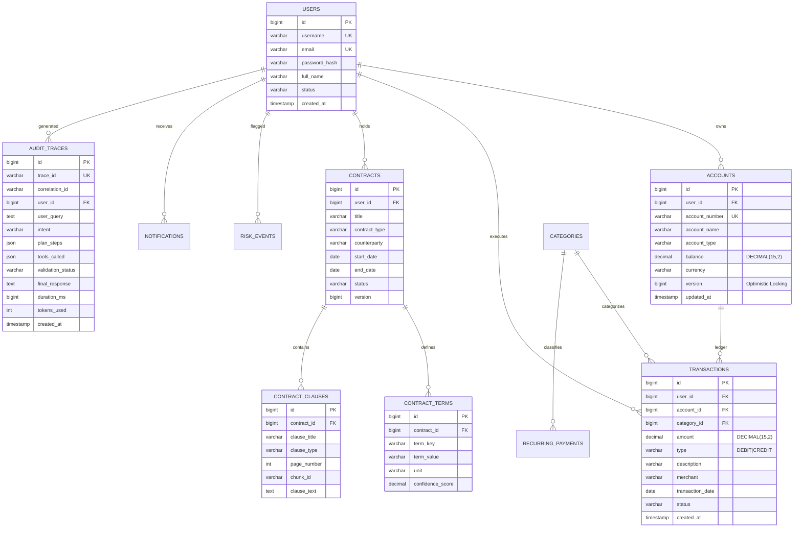

# FinOrchestrator — Database Design & Schema Specification

FinOrchestrator utilizes **MySQL 8.0** with strict normalization, relational integrity, indexes tailored for financial timeseries aggregation, and optimistic locking to prevent race conditions.

## 1. Schema Diagram

---

## 2. Critical Database Decisions

1. **Exact Precision for Financial Amounts (`DECIMAL(15, 2)`)**:
   - `FLOAT` or `DOUBLE` are strictly forbidden across all tables. All monetary amounts are stored as `DECIMAL(15, 2)` to eliminate binary floating-point round-off errors.
2. **Optimistic Locking (`version`)**:
   - The `accounts` table features a `version BIGINT DEFAULT 0` column annotated with `@Version` in JPA. Any concurrent balance modification detects race conditions and triggers automatic retry.
3. **Composite Aggregation Indexes**:
   - `idx_tx_user_date` (`user_id`, `transaction_date`, `type`) enables fast monthly expense aggregations (`sumAmountByUserIdAndTypeAndDateRange`).
   - `idx_tx_category` (`user_id`, `category_id`, `transaction_date`) optimizes category breakdown queries.
   - `idx_audit_trace` (`trace_id`, `correlation_id`) ensures fast lookups for observability and user explainability.
